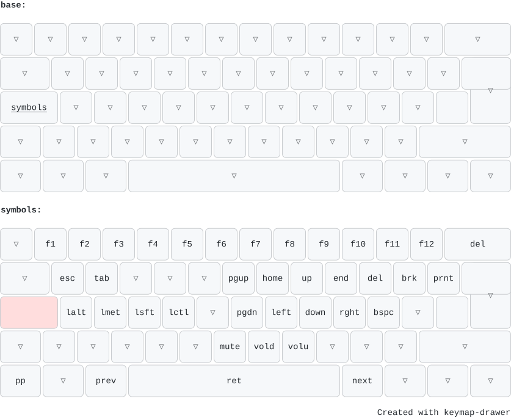

+++
title = "Kanata on Fedora"
date = 2026-10-09T22:50:05+02:00

[taxonomies]
tags = ["linux", "fedora", "input", "keyboard", "kanata"]
+++

## Introduction

Someone noticed that I can’t really touch-type, let alone type with all ten fingers (four is more like it). Since this
had been a weak spot for a long time, I decided to change that. Despite a really cool demonstration of the
Colemak-DH-Wide layout, with Caps Lock as an additional temporary layer switch for reaching the cursor keys and a few
others from the home row, I don’t want to learn a layout that I won’t find by default on most computers. So I’ll stick
with QWERTY.

But the temporary Caps Lock layer is really nice, so I extracted it from the full Kanata config that was kindly shared
along with the demonstration. (Thanks a lot, Chris!)

Here is the layout that I would like to use:



> [!TIP]
> [keymap-drawer](https://keymap-drawer.streamlit.app) can parse a Kanata config and render it as an SVG.

The configuration wasn't as straightforward as I initially thought. Here are the notes:

## Preparations

Kanata is not on the official Fedora Repos. There is a community maintained `copr`, but I prefer to build it directly in that case.

I already installed rustup and configured it. In case that needs to be done:

```bash
sudo dnf install rustup gcc
rustup-init -y
source "$HOME/.cargo/env"
```

## Install Kanata

```bash
rustup update stable
cargo install kanata
sudo install -m 755 ~/.cargo/bin/kanata /usr/local/bin/kanata
```

> [!NOTE]
> It is important to use `install` on Fedora instead of moving and chowning the file because of `SELinux`.
> When moving the executable from the home dir, the SELinux label `user_home_t` stays on the file and `systemd` refuses to start it with a `Permission denied error`.
>
> ```bash
> sudo restorecon -v /usr/local/bin/kanata
> ```
>
> fixes that.

Kanata needs the `uinput` module, so we make sure it is loaded:

```bash
echo uinput | sudo tee /etc/modules-load.d/uinput.conf
sudo modprobe uinput
```

I want Kanata to be started as a global and not as a user service, but I don't want it to be running as `root`. So we need to add a user (`kanata`), a group (`uinput`), and setup the permissions for the `/dev/uinput` device accordingly.

```bash
sudo groupadd --system uinput

sudo useradd --system --no-create-home --shell /usr/sbin/nologin --groups input,uinput kanata

echo 'KERNEL=="uinput", MODE="0660", GROUP="uinput", OPTIONS+="static_node=uinput", RUN+="/usr/bin/setfacl -m g:uinput:rw /dev/uinput"' \
  | sudo tee /etc/udev/rules.d/99-uinput.rules

sudo udevadm control --reload
sudo udevadm trigger --name-match=uinput
```

> [!NOTE]
> Somehow the `GROUP="uinput"` tag wasn't enough, so I had to add the `setfacl` command to add that rule.

## The configuration

```lisp,name=/etc/kanata/kanata.kbd
;; Kanata config: Caps Lock as symbols and navigation layer

(defcfg
  process-unmapped-keys yes
)

(defsrc
  grv  1    2    3    4    5    6    7    8    9    0    -    =    bspc
  tab  q    w    e    r    t    y    u    i    o    p    [    ]
  caps a    s    d    f    g    h    j    k    l    ;    '    #    ret
  lsft <    z    x    c    v    b    n    m    ,    .    /    rsft
  lctl lmet lalt           spc            ralt rmet cmp  rctl
)

(defalias
  sym (layer-while-held symbols)
)

(deflayer base
  _    _    _    _    _    _    _    _    _    _    _    _    _    _
  _    _    _    _    _    _    _    _    _    _    _    _    _
  @sym _    _    _    _    _    _    _    _    _    _    _    _    _
  _    _    _    _    _    _    _    _    _    _    _    _    _
  _    _    _              _              _    _    _    _
)

(deflayer symbols
  _    f1   f2   f3   f4   f5   f6   f7   f8   f9   f10  f11  f12  del
  _    esc  tab  _    _    _    pgup home up   end  del  brk  prnt
  _    lalt lmet lsft lctl _    pgdn left down rght bspc _    _    _
  _    _    _    _    _    _    mute vold volu _    _    _    _
  pp   _    prev           ret            next _    _    _
)
```

## systemd service

```ini,name=/etc/systemd/system/kanata.service
[Unit]
Description=Kanata keyboard remapper
After=systemd-modules-load.service systemd-udevd.service

[Service]
Type=simple
User=kanata
Group=kanata
SupplementaryGroups=input uinput
ExecStart=/usr/local/bin/kanata --cfg /etc/kanata/kanata.kbd
Restart=always
RestartSec=3

NoNewPrivileges=yes
ProtectSystem=strict
ProtectHome=yes
PrivateTmp=yes

[Install]
WantedBy=multi-user.target
```

Reload systemd and enable the service.

```bash
sudo systemctl daemon-reload
sudo systemctl enable --now kanata
journalctl -u kanata -f
```

## Update Kanata

```bash
rustup update stable
cargo install kanata
sudo install -m 755 ~/.cargo/bin/kanata /usr/local/bin/kanata
kanata --cfg /etc/kanata/kanata.kbd --check && sudo systemctl restart kanata
```
